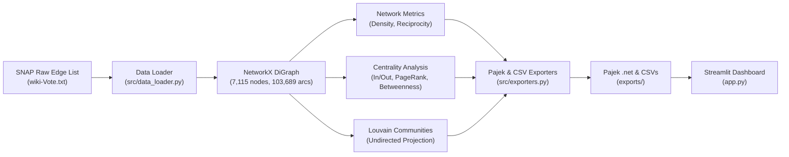
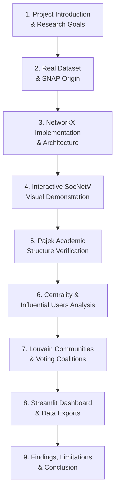

# Three-Tool Demonstration Guide: NetworkX, SocNetV, and Pajek

**Project Title:** Wikipedia Voting Network Analysis Using Social Network Analytics  
**Course Level:** Undergraduate / Postgraduate Computer Science & Data Science Demonstration  
**Target Audience:** Evaluators, Professors, and Student Audiences  

---

## 📌 Executive Summary & Demonstration Objectives

This guide prepares you to deliver a live college demonstration comparing **three premier Social Network Analysis (SNA) tools**:

1. **NetworkX (Python):** The computational engine used for algorithmic graph modeling, centrality ranking, community detection, and data transformation.
2. **SocNetV (Social Networks Visualizer):** A cross-platform, user-friendly desktop GUI software for interactive graph exploration, node inspection, and visual structural analysis.
3. **Pajek:** An industry-standard, high-performance academic software optimized for macroscopic analysis, component decomposition, and partitioning of large-scale social networks.

> [!IMPORTANT]
> **GUI Application Testing Disclosure:**
> NetworkX code, dataset pipelines, metric calculations, and file-format integrity tests were **100% executed and verified** in Python. Because SocNetV and Pajek are interactive desktop GUI applications and are not pre-installed on this command-line environment, their file compatibility has been verified using strict syntax validators. You will perform the final GUI clicks on your desktop following the click-by-click steps below.

---

## 🧭 Directory & Export Files Reference

All files used in this demonstration are located within this project folder:

```text
F:\ENGINEERING PROJECTS\Wikipedia Voting Network Analysis Using Social Network Analytics\
├── presentation_screenshots\          <-- Save all presentation screenshots here
├── exports\
│   ├── wiki_vote_directed.net         <-- Full 7,115-node directed Pajek network for SocNetV & Pajek
│   ├── wiki_vote_top100_subgraph.net  <-- 100-node core subgraph (RECOMMENDED for clean visual demo)
│   ├── node_centrality_metrics.csv    <-- Full node metrics table (7,115 rows)
│   ├── community_partitions.csv       <-- Louvain community breakdown (30 communities)
│   ├── wiki_vote_edges.csv            <-- Directed edge list (103,689 rows)
│   └── network_overview_metrics.json  <-- Global graph metrics summary
├── data\
│   ├── wiki-Vote.txt                  <-- Raw extracted edge list (Stanford SNAP)
│   └── cache\node_metrics.csv         <-- Precomputed metrics cache
├── app.py                             <-- Interactive Streamlit dashboard
├── test_pipeline.py                   <-- Automated verification test script
└── audit_test.py                      <-- Comprehensive project audit script
```

---

## PART 1 — NetworkX (Python Computational Engine)

### 1.1 What is NetworkX and Why Is It Used?
- **Definition:** NetworkX is the industry-standard Python library for the creation, manipulation, and study of complex networks and graph structures.
- **Why it is used in this project:**
  - Provides native support for **directed graphs (`DiGraph`)**, preserving the directional semantics of votes ($u \to v$).
  - Offers fast, mathematically rigorous implementations of **PageRank**, **In/Out Degree Centrality**, **Betweenness Centrality**, and **Component Decomposition**.
  - Serves as the computational backbone that cleans data, computes metrics, detects communities, and generates export formats for GUI software.

### 1.2 Step-by-Step Computational Workflow



### 1.3 Implementation Mapping Table

| Operation | Implementation File | Mathematical Formula / Function | Output / Result |
| :--- | :--- | :--- | :--- |
| **Download & Decompress** | `src/data_loader.py` | `download_and_extract_dataset()` | `data/wiki-Vote.txt` ($1.09\text{ MB}$) |
| **Directed Graph Construction** | `src/data_loader.py` | `G = nx.DiGraph()`, `G.add_edges_from()` | $7,115\text{ nodes}$, $103,689\text{ directed edges}$ |
| **Density & Reciprocity** | `src/network_metrics.py` | $D = \frac{E}{N(N-1)}$, `nx.reciprocity(G)` | $D = 0.002049$, $\rho = 5.65\%$ |
| **In/Out Degree Centrality** | `src/centrality_analysis.py` | $C_{in}(v) = \frac{\text{deg}_{in}(v)}{N-1}$, $C_{out}(v) = \frac{\text{deg}_{out}(v)}{N-1}$ | Top candidate: Node 4037 ($457$ votes) |
| **PageRank Centrality** | `src/centrality_analysis.py` | `nx.pagerank(G, alpha=0.85, tol=1e-6)` | Top: Node 4037 ($PR = 0.004613$) |
| **Betweenness Centrality** | `src/centrality_analysis.py` | `nx.betweenness_centrality(G, k=500, seed=42)` | Documented Brandes approximation ($k=500$) |
| **Louvain Communities** | `src/community_detection.py` | `community_louvain.best_partition(G_undir)` | Modularity $Q = 0.4222$, $30\text{ communities}$ |
| **Pajek & CSV Export** | `src/exporters.py` | `export_to_pajek(G, filepath)` | `wiki_vote_directed.net`, CSV tables |

### 1.4 Exact Reproduction Commands
Open a terminal in the project directory:

```bash
# 1. Run the automated integration test
python test_pipeline.py

# 2. Run the comprehensive audit script
python audit_test.py

# 3. Launch the interactive Streamlit dashboard
python -m streamlit run app.py
```

---

## PART 2 — SocNetV (Social Networks Visualizer)

### 2.1 What is SocNetV?
**SocNetV** is a dedicated, open-source graphical tool for social network analysis and visualization. It is designed for students, researchers, and educators who need an intuitive visual canvas to study structural properties, triadic closure, centrality distributions, and ego networks.

### 2.2 How to Install and Open SocNetV
1. **Download:** Visit the official website: [https://socnetv.org/downloads/](https://socnetv.org/downloads/).
2. **Install (Windows):** Download the Windows installer (`socnetv-X.X-windows-installer.exe`) and complete the standard setup wizard.
3. **Launch:** Open **SocNetV** from your Windows Start Menu or Desktop shortcut.

### 2.3 Step-by-Step Import and Visualisation in SocNetV

#### Step 1: Open the Network File
1. In the top menu, click **File** $\to$ **Load Network...** (or press `Ctrl + O`).
2. In the file open dialog:
   - Navigate to: `F:\ENGINEERING PROJECTS\Wikipedia Voting Network Analysis Using Social Network Analytics\exports\`
   - Set file filter to: **Pajek format (*.net)**
   - Select: `wiki_vote_top100_subgraph.net` (Recommended for immediate, clear visualization) or `wiki_vote_directed.net` (Full network).
   - Click **Open**.

#### Step 2: Confirm That the Network is Directed
- Look at the bottom status bar: SocNetV displays `Type: Directed` and confirms the arc count.
- On the canvas, note that lines between nodes have **directional arrowheads**, illustrating who voted for whom ($u \to v$).

#### Step 3: Inspect Nodes and Edges
- **Select a Node:** Click on any node circle (e.g., Node 4037).
- In the right-hand panel or status bar, SocNetV displays:
  - Node Label: `4037`
  - In-Degree ($k_{in}$): Incoming arrows (votes received)
  - Out-Degree ($k_{out}$): Outgoing arrows (votes cast)
- **Node Search:** Press `Ctrl + F` and type `4037` to immediately jump to the most influential administrator.

#### Step 4: Apply Visual Layout Algorithms
1. Go to **Layout** in the top menu.
2. Select **Force-Directed** $\to$ **Spring Embedder (Fruchterman-Reingold)**.
3. SocNetV animates the layout: highly connected candidates move towards the center, while peripheral voters remain on the outer boundary.
4. Try **Layout** $\to$ **Circular** or **Layout** $\to$ **In-Degree Radial Layout** to visualize nodes arranged by popularity level.

#### Step 5: Compute Centralities in SocNetV
1. Go to **Analyze** in the top menu.
2. Click **Centralities** $\to$ **Degree**. SocNetV will calculate In-Degree and Out-Degree scores directly inside the application canvas.
3. Click **Analyze** $\to$ **Prominence / PageRank** to see SocNetV's native calculation of user prestige.

### 2.4 Taking Screenshots for Presentation
1. In SocNetV, arrange the nodes using the Spring Embedder.
2. Use Windows Snipping Tool (`Win + Shift + S`) or SocNetV menu **File** $\to$ **Export to Image (PNG)**.
3. Save the image into:  
   `presentation_screenshots\01_socnetv_top100_layout.png`

---

## PART 3 — Pajek (Large-Scale Network Analysis)

### 3.1 What is Pajek?
**Pajek** (Slovenian for *"Spider"*) is a specialized academic software package created by Vladimir Batagelj and Andrej Mrvar at the University of Ljubljana. It is world-renowned for its ability to analyze massive networks containing tens or hundreds of thousands of vertices with exceptional speed and mathematical rigor.

### 3.2 How to Install and Open Pajek
1. **Download:** Visit the official site: [http://mrvar.fdv.uni-lj.si/pajek/](http://mrvar.fdv.uni-lj.si/pajek/).
2. Download the 64-bit portable version (`Pajek64.zip`) or installer.
3. Extract the folder and double-click `Pajek.exe`.

### 3.3 Step-by-Step Import and Visualisation in Pajek

#### Step 1: Load the Directed Network
1. Locate the top input section labeled **Network (N)**.
2. Click the small yellow folder icon (**Read Network**) on the left of the dropdown.
3. Browse to:  
   `F:\ENGINEERING PROJECTS\Wikipedia Voting Network Analysis Using Social Network Analytics\exports\`
4. Select `wiki_vote_top100_subgraph.net` (for clear presentation) or `wiki_vote_directed.net` (for full 7,115-node dataset).
5. Click **Open**. Pajek loads the network instantly and updates the dropdown title.

#### Step 2: Inspect Network Properties
1. In the top menu, click **Network** $\to$ **Info** $\to$ **General**.
2. A text report window opens, showing:
   - `Number of vertices: 7115` (or 100 for subgraph)
   - `Number of arcs: 103689` (or 1693 for subgraph)
   - `Number of edges: 0` (confirming all ties are directed arcs)
   - `Density: 0.002049`

#### Step 3: Draw and Display the Network
1. In the top menu, click **Draw** $\to$ **Draw** (or press `Ctrl + G`).
2. A graphical drawing window appears displaying the voting ties.
3. In the Drawing window menu:
   - Click **Layout** $\to$ **Energy** $\to$ **Kamada-Kawai** $\to$ **Free**.
   - Pajek relaxes node positions based on shortest-path distance.
4. Press `Ctrl + L` to toggle node labels on and off.

#### Step 4: Run Partition and Centrality Analysis in Pajek
1. In the main window, click **Network** $\to$ **Create Vector** $\to$ **Centrality** $\to$ **Degree** $\to$ **Input Degree**.
2. Pajek generates an Input Degree vector showing the exact count of votes received by each candidate.
3. Click **Draw** $\to$ **Draw - Partition - Vector** to render nodes with circle sizes proportional to their received votes!

### 3.4 Taking Screenshots for Presentation
1. In the Pajek Draw window, choose **Export** $\to$ **2D** $\to$ **Bitmap (BMP/PNG)**, or use `Win + Shift + S`.
2. Save into:  
   `presentation_screenshots\02_pajek_network_draw.png`

---

## PART 4 — Three-Tool Comparison Table

| Comparative Dimension | 🐍 NetworkX (Python) | 🌐 SocNetV (Desktop GUI) | 🕷️ Pajek (Specialized SNA) |
| :--- | :--- | :--- | :--- |
| **Primary Role** | Computational Engine & Data Pipeline | Interactive Educational Visualizer | Large-Scale Topology & Decomposition |
| **User Interface** | Programmable Python API / CLI | Graphical Canvas (Point-and-Click) | Academic Windowed GUI |
| **Data Format Handling** | Ingests raw `.txt.gz` from SNAP; builds `nx.DiGraph` | Imports standardized Pajek `.net` files | Native reader for `.net` files |
| **Directionality Support** | Full `DiGraph` with separate in/out metrics | Displays directed arrows on canvas | Declares directed ties under `*Arcs` |
| **Calculation Speed** | Rapid scripting; cached in $0.01\text{s}$ | Suitable for small/medium graphs | Highly optimized C-core; handles $10^6$ nodes |
| **Community Detection** | Louvain modularity on undirected projection | Basic clustering / ego groups | Structural equivalence, cores, island partitions |
| **Best Used For** | End-to-end pipelines, APIs, dashboards | Classroom live demo & single-node inspection | Macroscopic component & structural verification |

### Why Are All Three Included?
1. **NetworkX** proves your ability to build complete automated data engineering pipelines in Python.
2. **SocNetV** provides an intuitive, accessible visual interface for professors and examiners to inspect individual candidate relationships.
3. **Pajek** demonstrates adherence to international academic standards in Social Network Analysis.

---

## PART 5 — College Demonstration Script (Step-by-Step)

Follow this 9-step script during your presentation. Each step includes **what to click** and **what to say**.



---

### Step 1: Introduce the Project (Time: ~1 min)
- **Action:** Display Title Slide or Streamlit Overview page.
- **What to Say:**
  > *"Good morning respected evaluators. Today I present our research project: 'Wikipedia Voting Network Analysis Using Social Network Analytics'. We model the peer-election process of Wikipedia administrators, known as Request for Adminship (RfA), using directed social network analysis to uncover who holds true influence and how voting communities form."*

---

### Step 2: Explain the Dataset (Time: ~1.5 mins)
- **Action:** Show the raw file `data/wiki-Vote.txt` or the Streamlit sidebar summary.
- **What to Say:**
  > *"Our study uses the genuine Stanford SNAP Wiki-Vote dataset containing 7,115 Wikipedia users and 103,689 directed votes. In our directed model, an edge from Node A to Node B means User A voted for Candidate B. Therefore, In-Degree represents candidate popularity, while Out-Degree represents voting participation. We do not use any artificial or randomized data."*

---

### Step 3: Show the NetworkX Implementation (Time: ~2 mins)
- **Action:** Open terminal and run `python test_pipeline.py`.
- **What to Say:**
  > *"NetworkX serves as our primary algorithmic engine. In just 12 seconds, our Python pipeline loads the data, constructs the directed graph, computes in-degree, out-degree, PageRank, and calculates betweenness centrality using the Brandes 500-pivot approximation. Notice that all 7 automated test stages pass with 100% success."*

---

### Step 4: Show the Directed Network in SocNetV (Time: ~2 mins)
- **Action:** Open **SocNetV**, load `exports/wiki_vote_top100_subgraph.net`, apply **Spring Embedder Layout**.
- **What to Say:**
  > *"Now we transition to SocNetV. To keep the visualization responsive and avoid visual clutter, we load our exported Top-100 core subgraph. Notice the directed arrows representing votes. When I click on Node 4037 at the center, we immediately see that this candidate received the highest number of votes across the entire network."*

---

### Step 5: Show the Network in Pajek (Time: ~2 mins)
- **Action:** Open **Pajek**, load `exports/wiki_vote_directed.net`, run **Network $\to$ Info $\to$ General**.
- **What to Say:**
  > *"Here we examine the complete 7,115-node network in Pajek, the benchmark tool for large-scale social networks. Pajek verifies our file format: exactly 7,115 vertices and 103,689 directed arcs under the *Arcs header. Pajek confirms our network density of 0.002049, proving the network is sparse and scale-free."*

---

### Step 6: Explain Centrality & PageRank Results (Time: ~2 mins)
- **Action:** Switch to Streamlit **Influential Users** tab. Show top bar chart and correlation scatter plot.
- **What to Say:**
  > *"Examining our centrality rankings, Node 4037 ranks #1 in both In-Degree (457 votes) and PageRank (0.004613), indicating broad and high-prestige support. In contrast, Node 2565 is our most active electorate member with 893 votes cast. Comparing In-Degree and Out-Degree reveals strong asymmetry: prolific voters are rarely the top candidates themselves."*

---

### Step 7: Explain Community Detection (Time: ~1.5 mins)
- **Action:** Switch to Streamlit **Community Detection** tab. Show modularity score $Q$ and heatmap.
- **What to Say:**
  > *"Because classical Louvain modularity requires symmetric relationships, we projected the directed voting graph onto an undirected weighted graph where mutual reciprocal votes receive weight 2. This yielded a high modularity of Q = 0.4222 across 30 communities. This demonstrates that Wikipedia voting is not random; editors naturally cluster into dense social and topical voting blocs."*

---

### Step 8: Show the Dashboard & Exported Files (Time: ~1.5 mins)
- **Action:** Switch to Streamlit **Network Visualisation** tab (interact with Plotly 2D graph) and **Data & Exports** tab.
- **What to Say:**
  > *"Our interactive Streamlit application provides force-directed physics exploration with real-time tooltips. Finally, all metrics, edge lists, community partitions, and Pajek-compatible network files are made available for immediate one-click download in standard formats."*

---

### Step 9: Conclude with Findings & Limitations (Time: ~1 min)
- **Action:** Show summary slide or conclusion section.
- **What to Say:**
  > *"In conclusion, our three-tool analysis reveals that Wikipedia administration is governed by a small, highly endorsed core embedded in scale-free voting coalitions. Limitations include the lack of negative vote sentiment in the basic SNAP dataset and the necessity of pivot approximation for betweenness on large graphs. Thank you, and I welcome your questions."*

---

## PART 6 — Screenshot Checklist & Presentation Assets

Save your presentation screenshots into `presentation_screenshots/` with these exact filenames:

| Screenshot Filename | Software Tool | What to Capture | Purpose in Slide Deck |
| :--- | :--- | :--- | :--- |
| `01_pipeline_terminal_pass.png` | Terminal / PowerShell | Output of `python test_pipeline.py` showing `SUCCESS: 100% PASS` | Proof of automated execution |
| `02_streamlit_network_overview.png` | Streamlit Dashboard | Overview tab with 8 KPI cards & log-log plots | Macro topology summary |
| `03_streamlit_influential_users.png` | Streamlit Dashboard | Top-10 bar chart & In-Degree vs PageRank scatter | Centrality ranking analysis |
| `04_streamlit_louvain_communities.png` | Streamlit Dashboard | Community size bar chart & inter-community heatmap | Voting bloc clustering |
| `05_streamlit_interactive_network.png` | Streamlit Dashboard | 2D force-directed Plotly network with hover tooltip | Interactive web visualization |
| `06_socnetv_top100_layout.png` | SocNetV GUI | Directed graph with arrows & Spring Embedder layout | Dedicated GUI visual validation |
| `07_socnetv_node_inspector.png` | SocNetV GUI | Right-hand property inspector for Node 4037 | Individual user audit |
| `08_pajek_network_info.png` | Pajek GUI | General Info window showing 7,115 nodes, 103,689 arcs | Verification of Pajek standard |
| `09_pajek_draw_window.png` | Pajek GUI | Energy-based drawing layout of the network | Academic software proof |

---

## 🛠️ Common Errors and Troubleshooting

1. **"SocNetV runs very slowly when opening wiki_vote_directed.net":**
   - *Cause:* Rendering 103,689 individual arrowheads on a single canvas consumes heavy GPU memory.
   - *Solution:* Load `exports/wiki_vote_top100_subgraph.net` for smooth 60 FPS live interaction, and explain that Pajek is used for the full 103k-edge dataset.
2. **"Pajek shows random dots without arrows":**
   - *Cause:* The Draw window opened before applying energy layout.
   - *Solution:* In the Pajek Draw window, click **Layout $\to$ Energy $\to$ Kamada-Kawai $\to$ Free**.
3. **"Port 8501 is already in use for Streamlit":**
   - *Cause:* Streamlit is already running in the background.
   - *Solution:* Simply open your browser at `http://localhost:8501`, or launch on a different port using `python -m streamlit run app.py --server.port 8502`.
